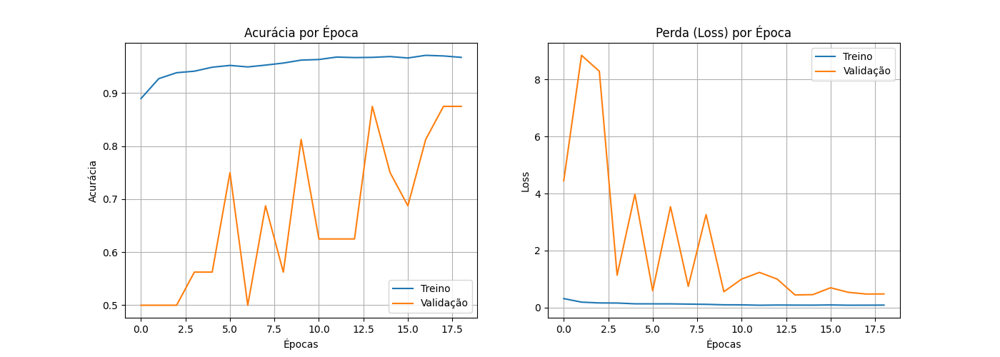
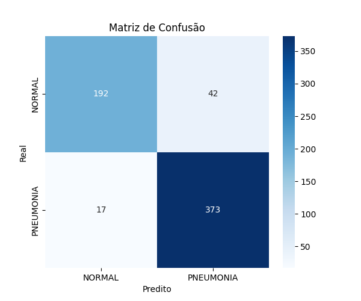

# RELATÓRIO TÉCNICO E DOCUMENTAÇÃO DO PROJETO
## Sistema Inteligente de Suporte ao Diagnóstico Radiológico de Pneumonia via Redes Neurais Convolucionais (CNN)

---

**Curso:** Pós-Graduação / POSTECH
**Desafio:** Tech Challenge - Fase 1 (Componente EXTRA: Visão Computacional)
**Domínio:** Triagem Médica e Auxílio ao Diagnóstico Clínico por Imagem
**Tecnologias:** Python 3, Keras, TensorFlow, Scikit-Learn, Matplotlib, Seaborn

---

## 1. Resumo Executivo e Contexto do Problema

Com o aumento constante do volume de pacientes nos hospitais universitários, a triagem rápida de exames de imagem torna-se essencial para priorizar casos graves e otimizar a alocação de recursos médicos. A pneumonia é uma infecção respiratória aguda grave que afeta os pulmões e exige diagnóstico e intervenção terapêutica céleres.

Este trabalho apresenta o desenvolvimento, implementação e avaliação de um modelo baseado em **Redes Neurais Convolucionais (CNN)** focado na classificação automática de radiografias de tórax (*Chest X-Ray*) em duas categorias: **NORMAL** e **PNEUMONIA**.

O objetivo do sistema não é substituir a decisão médica, mas atuar como uma **ferramenta de suporte à decisão clínica e triagem automatizada**, destacando imagens suspeitas para priorização na fila de laudo radiológico.

---

## 2. Descrição do Dataset e Pré-processamento

### 2.1. Estrutura dos Dados
O projeto utilizou o dataset público de radiografias pediátricas de tórax (*Chest X-Ray Images - Pneumonia*, Kaggle). Os dados foram organizados nas seguintes divisões:

* **Treino (`train`):** 5.216 imagens (distribuídas entre as classes NORMAL e PNEUMONIA)
* **Validação (`val`):** 16 imagens
* **Teste (`test`):** 624 imagens (234 NORMAL / 390 PNEUMONIA)

### 2.2. Pipeline de Pré-processamento e Data Augmentation
Devido ao desequilíbrio entre classes e à variabilidade de rotação e enquadramento nas radiografias do mundo real, aplicou-se um pipeline rigoroso de pré-processamento via `ImageDataGenerator`:

1. **Redimensionamento (*Resizing*):** As imagens foram padronizadas para a dimensão de $150 \times 150$ pixels com 3 canais de cor (RGB).
2. **Normalização de Escala (*Rescaling*):** Reescalonamento dos valores de pixel de $[0, 255]$ para o intervalo $[0, 1]$ dividindo por $255.0$.
3. **Aumento de Dados (*Data Augmentation*):** Aplicado estritamente ao conjunto de treinamento para prevenção de *overfitting*:
   * Rotação aleatória de até 15 graus (`rotation_range=15`)
   * Deslocamentos horizontal e vertical de até 10% (`width_shift_range=0.1`, `height_shift_range=0.1`)
   * Deformação por cisalhamento (*Shear*) de 10% (`shear_range=0.1`)
   * Zoom aleatório de até 10% (`zoom_range=0.1`)
   * Espelhamento horizontal (`horizontal_flip=True`)

---

## 3. Arquitetura do Modelo CNN

Construiu-se uma rede convolucional profunda em blocos sequenciais, combinando extração de recursos hierárquicos e técnicas modernas de regularização.

### 3.1. Estrutura da Rede
* **Bloco Convolucional 1:** `Conv2D` (32 filtros, $3 \times 3$, ReLU) $\rightarrow$ `BatchNormalization` $\rightarrow$ `MaxPooling2D` ($2 \times 2$)
* **Bloco Convolucional 2:** `Conv2D` (64 filtros, $3 \times 3$, ReLU) $\rightarrow$ `BatchNormalization` $\rightarrow$ `MaxPooling2D` ($2 \times 2$)
* **Bloco Convolucional 3:** `Conv2D` (128 filtros, $3 \times 3$, ReLU) $\rightarrow$ `BatchNormalization` $\rightarrow$ `MaxPooling2D` ($2 \times 2$)
* **Bloco Convolucional 4:** `Conv2D` (128 filtros, $3 \times 3$, ReLU) $\rightarrow$ `BatchNormalization` $\rightarrow$ `MaxPooling2D` ($2 \times 2$)
* **Camada de Achatamento:** `Flatten`
* **Camada Densa Oculta:** `Dense` (512 neurônios, ReLU)
* **Regularização:** `Dropout(0.5)` (desativa 50% dos neurônios durante o treino para combater *overfitting*)
* **Camada de Saída:** `Dense` (1 neurônio, ativação Sigmoide para classificação binária)

### 3.2. Hiperparâmetros e Callbacks de Treinamento
* **Otimizador:** Adam (taxa de aprendizado inicial $1 \times 10^{-4}$)
* **Função de Perda:** Binária Entropia Cruzada (*Binary Crossentropy*)
* **Estratégias de Controle:**
  * `ModelCheckpoint`: Salvamento automático do modelo com menor perda na validação (`val_loss`) no arquivo `pneumonia_cnn_best.keras`.
  * `EarlyStopping`: Interrupção do treino após 5 épocas sem melhoria na perda de validação, restaurando os melhores pesos.
  * `ReduceLROnPlateau`: Redução da taxa de aprendizado por um fator de 0.2 quando a perda de validação estagnou por 3 épocas.

---

## 4. Resultados e Métricas de Avaliação

O modelo foi avaliado no conjunto de teste composto por 624 radiografias inéditas.

Precisão, recall e F1-score abaixo referem-se à classe positiva `PNEUMONIA`. Os resultados descrevem apenas este conjunto de teste e não comprovam desempenho em dados externos.

### 4.1. Métricas Globais

| Métrica | Valor Obtido |
| :--- | :---: |
| **Acurácia (*Accuracy*)** | **90.54%** |
| **Sensibilidade (*Recall* / Revocação)** | **95.64%** |
| **Precisão (*Precision*)** | **89.88%** |
| **F1-Score** | **92.67%** |

### 4.2. Relatório de Classificação Detalhado

```
              precision    recall  f1-score   support

      NORMAL       0.92      0.82      0.87       234
   PNEUMONIA       0.90      0.96      0.93       390

    accuracy                           0.91       624
   macro avg       0.91      0.89      0.90       624
weighted avg       0.91      0.91      0.90       624
```

### 4.3. Curvas de treinamento

A figura mostra as métricas por época. A validação apresenta oscilações acentuadas, compatíveis com o conjunto de validação muito pequeno (16 imagens); por isso, essas curvas devem ser interpretadas com cautela e não comprovam generalização.



### 4.4. Análise da Matriz de Confusão

| Real \ Predito | NORMAL (Predito) | PNEUMONIA (Predito) | Total Real |
| :--- | :---: | :---: | :---: |
| **NORMAL (Real)** | **192** *(Verdadeiro Negativo)* | **42** *(Falso Positivo)* | 234 |
| **PNEUMONIA (Real)** | **17** *(Falso Negativo)* | **373** *(Verdadeiro Positivo)* | 390 |



---

## 5. Análise Crítica e Discussão Médica

### 5.1. Justificativa da Métrica Chave: O Papel Fundamental do Recall
No contexto hospitalar, **o custo de um Falso Negativo é desproporcionalmente superior ao de um Falso Positivo**. Liberar um paciente infectado com pneumonia sem o devido tratamento por erro de triagem pode levar à sepse, complicações respiratórias graves e óbito.

Por outro lado, um Falso Positivo (classificar um exame normal como suspeito de pneumonia) apenas encaminha a imagem para revisão prioritária pelo médico radiologista, que descartará o alarme sem prejuízo vital ao paciente.

O modelo obteve um **Recall de 95.64% para Pneumonia** (detectando 373 dos 390 casos reais) neste conjunto de teste. Esse resultado é uma observação experimental e, isoladamente, não comprova eficácia como mecanismo clínico de segurança ou triagem.

### 5.2. Aplicação Prática no Workflow Hospitalar
O fluxo abaixo é uma possibilidade conceitual de aplicação futura; não foi implementado nem validado neste projeto:
1. **Triagem Automatizada de Entrada:** À medida que exames de raio-X são realizados e enviados ao PACS (*Picture Archiving and Communication System*), o modelo executa a predição em tempo real.
2. **Priorização da Fila de Laudos:** Pacientes com predição `PNEUMONIA` recebem tag prioritária no sistema do hospital, reduzindo o tempo de espera para avaliação médica.
3. **Decisão Final Centrada no Médico:** Em qualquer cenário futuro de uso, a avaliação e a decisão clínica devem permanecer sob responsabilidade de profissionais de saúde qualificados. O modelo não substitui diagnóstico médico.

---

## 6. Estrutura dos Artefatos Gerados

O notebook e este relatório estão versionados no repositório em `notebooks/pneumonia_cnn.ipynb` e `docs/relatorio_tecnico_cnn_pneumonia.md`. O dataset, o modelo treinado e os resultados da execução foram armazenados no Google Drive e não são incluídos no repositório:

```text
Meu Drive/
├── datasets/
│   └── chest_xray/
│       ├── train/
│       ├── val/
│       └── test/
├── pneumonia_cnn.ipynb
└── pneumonia_cnn_resultados/
    ├── pneumonia_cnn_best.keras      # Pesos do melhor modelo treinado
    ├── curvas_treinamento.png        # Gráficos de acurácia e loss por época
    ├── matriz_confusao.png           # Visualização gráfica da matriz de confusão
    └── relatorio_classificacao.txt   # Relatório numérico completo exportado
```

---

## 7. Conclusão

A implementação da Rede Neural Convolucional atendeu ao objetivo acadêmico de explorar a classificação de radiografias de tórax. No conjunto de teste utilizado, o modelo alcançou **90.54% de acurácia** e **95.64% de recall para Pneumonia**. Como o conjunto de validação contém apenas 16 imagens e não foi realizada validação externa ou prospectiva, esses resultados não demonstram generalização para outras populações nem justificam uso clínico. O modelo tem finalidade exclusivamente educacional e experimental.